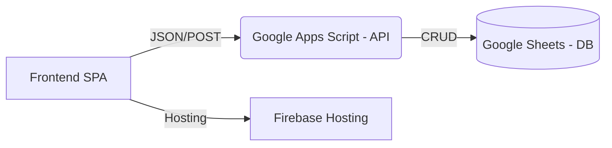

# 🏥 Sistema de Gestión y Seguimiento Nutricional - EHS Hunter

## 📄 Descripción

Sistema integral de gestión médica y seguimiento nutricional diseñado para el departamento de EHS (Environment, Health & Safety). Permite la captura, análisis y visualización de datos de salud de empleados, con enfoque en condiciones crónico-degenerativas y programas de bienestar ocupacional.

**URL de Producción:** [https://seguimientocronicodegenerativos.web.app](https://seguimientocronicodegenerativos.web.app)

---

## 🚀 Características Principales

### 🔐 Sistema de Autenticación
- **Multi-usuario**: Soporte para múltiples usuarios con roles diferenciados.
- **Seguridad**: Hashing SHA-256 para contraseñas y tokens de sesión.
- **Recuperación**: Generación de claves temporales y rotación forzada.

### 📋 Gestión de Expedientes
- **Datos Completos**: Personales, laborales, biométricos, signos vitales y antecedentes.
- **Cálculos Automáticos**: IMC, clasificaciones de riesgo y antigüedades.
- **Validación**: Reglas de negocio para evitar datos inconsistentes.

### 📊 Dashboard Analítico
- **KPIs en Tiempo Real**: Total empleados, promedios, % de riesgo.
- **Visualización**: Gráficas interactivas con ApexCharts (Distribución IMC, Riesgos, etc.).
- **Filtros**: Por planta, programa, género y turno.

### 📄 Reportes
- **PDF**: Generación de fichas técnicas individuales con diseño corporativo.
- **Excel**: Exportación de datos (vía SheetJS).

---

## 🛠️ Stack Tecnológico

### Arquitectura Serverless



| Capa | Tecnología | Descripción |
|------|------------|-------------|
| **Frontend** | HTML5, CSS3, JS (Vanilla) | SPA modular desplegada en Firebase Hosting. |
| **Backend** | Google Apps Script (GAS) | API REST serverless que procesa la lógica de negocio. |
| **Base de Datos** | Google Sheets | Almacenamiento estructurado y flexible. |
| **Visualización** | ApexCharts | Gráficas interactivas modernas. |

---

## 📂 Estructura del Proyecto

```
Gestion y Seguimiento Nutricional/
├── assets/                 # Recursos visuales y branding
│   ├── branding/           # Logos (EHS.png, logoscd.png)
│   └── backgrounds/        # Fondos de pantalla dinámicos
├── src/                    # Código Fuente
│   ├── client/             # Frontend (SPA)
│   │   ├── index.html      # Punto de entrada
│   │   ├── index.css
│   │   └── js/             # Módulos JavaScript
│   └── server/             # Backend (Google Apps Script)
│       └── Code.gs
├── Framework/              # Framework Xena / Core
├── docs/                   # Documentación Técnica
│   ├── MANUAL_DE_USUARIO.md
│   └── README.md
├── firebase.json           # Configuración de Hosting (Rewrites)
└── manifest.json           # Configuración PWA
```

### Descripción de Módulos JS

- **`app.js`**: Controlador principal. Maneja la navegación entre "pasos" del formulario, validaciones de campos, persistencia de borradores (`localStorage`) y lógica de interacción UI (modales, tabs).
- **`auth.js`**: Maneja el ciclo de vida de la sesión. Incluye funciones para `login`, `logout`, cambio de contraseña y validación de tokens.
- **`dashboard.js`**: Contiene la lógica para obtener datos del backend y renderizar las gráficas de ApexCharts. Calcula estadísticas en el cliente para reducir carga al servidor.
- **`Code.gs`**: Script del lado del servidor (Google Apps Script). Expone una API `doPost` que maneja todas las solicitudes (CRUD, Auth, Dashboard). Implementa un motor dinámico (V6) que se adapta a las columnas de la hoja de cálculo.

---

## ⚙️ Configuración y Despliegue

### Requisitos Previos
1. **Node.js** (v16+)
2. **Firebase CLI**: `npm install -g firebase-tools`
3. **Cuenta de Google**: Acceso al proyecto de Firebase y al Spreadsheet/Script.

### Instalación Local

1.  **Clonar/Descargar** el proyecto.
2.  **Iniciar Servidor**:
    ```bash
    firebase serve --only hosting
    ```
3.  Acceder en `http://localhost:5000`.

### Despliegue a Producción

1.  **Compilar/Minificar** (Opcional, el proyecto actual usa archivos crudos).
2.  **Desplegar**:
    ```bash
    firebase deploy --only hosting
    ```

### Actualización del Backend (Apps Script)

El archivo `Code.gs` es la fuente de verdad del backend. Para actualizarlo:
1. Copiar el contenido de `Code.gs`.
2. Ir a [script.google.com](https://script.google.com) asociado a la hoja de cálculo.
3. Pegar el código y guardar.
4. **Importante**: Implementar como nueva versión web (Deploy > New Deployment) para que los cambios se reflejen en la URL de producción si cambia la URL (aunque usualmente se mantiene la misma si se usa "versioning").

---

## 🔗 Enlaces Importantes

- **Producción**: [https://seguimientocronicodegenerativos.web.app](https://seguimientocronicodegenerativos.web.app)
- **Consola Firebase**: [https://console.firebase.google.com/project/seguimientonutricionalhunter](https://console.firebase.google.com/project/seguimientonutricionalhunter)
- **Repositorio/Carpeta**: Local en `Desktop/Hunter/Gestion y Seguimiento Nutricional`.

---

## 👥 Equipo
- **Desarrollo**: EHS Hunter / Asistente IA
- **Departamento**: EHS - Environment, Health & Safety
- **Empresa**: Hunter Industries

© 2024-2026 EHS Medical Department
